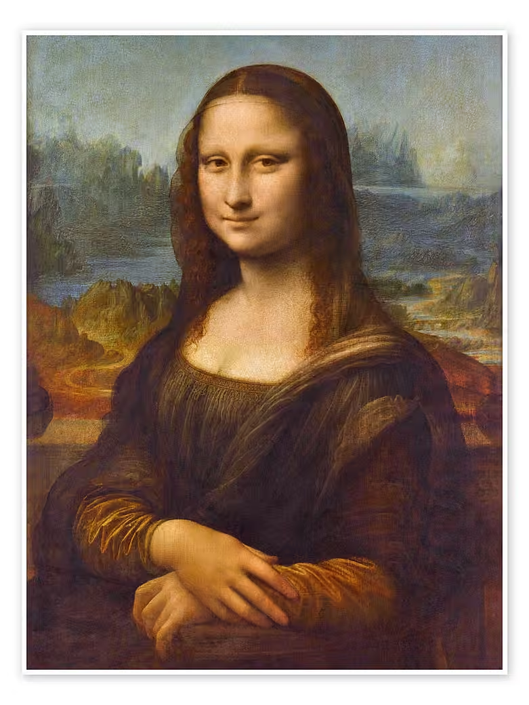
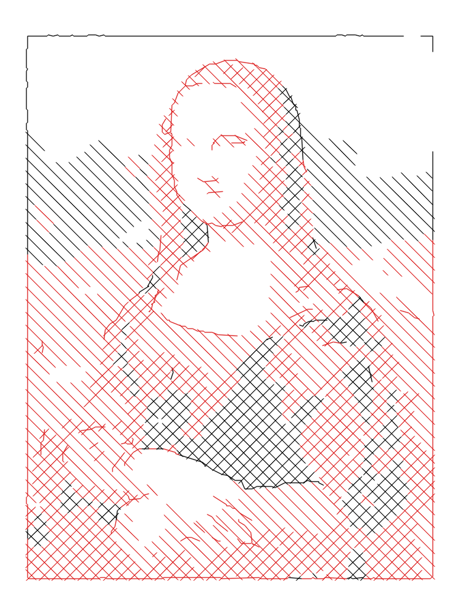
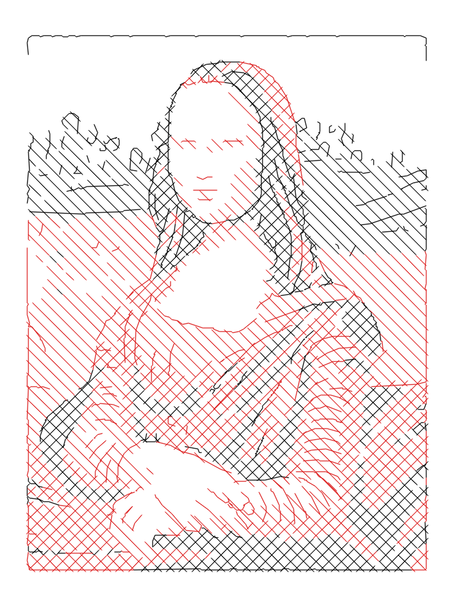

# UR Drawing Script

Turn an image into a pen drawing for a **Universal Robots (UR)** arm. The tool turns an image into strokes and writes ready-to-run **URScript** programs, one per pen colour, plus a preview of what the robot will draw.

| Source | Comic style, 2 pens | AI restyle + comic, 2 pens |
|---|---|---|
|  |  |  |

## Features

- **Two drawing styles**
  - `edges`: clean outlines, from Canny edge detection.
  - `comic`: ink lines plus shading drawn as hatching and cross-hatching.
- **Up to 4 pen colours** (black, green, red, blue). Each stroke gets the pen that matches the image underneath it, and one script is written per colour.
- **Tk GUI**:
  - Drag and drop an image, and every setting updates the preview live.
  - The estimated drawing time is shown per pen.
  - Live webcam mode, refreshed every few seconds.
  - One-click save of the image, preview and scripts.
- **Optional AI restyle**: Stable Diffusion 1.5 image-to-image with a lineart ControlNet redraws the image as a comic before it is turned into strokes. Needs an NVIDIA GPU.
- **Previews**: a preview PNG is written for every result, so you can check it before the robot moves.

## Requirements

- [uv](https://docs.astral.sh/uv/). Each script declares its own dependencies, so `uv run` installs everything automatically. No manual `pip install` is needed.
- A UR robot with PolyScope and a pen mounted on the tool flange.
- Optional, for AI restyle: an NVIDIA GPU with about 6 GB or more of VRAM, plus about 3.5 GB of disk for the model weights.

Tested on Windows 11 with an RTX 5070 Laptop GPU.

## Quick start

Run all commands from the repository root.

**GUI**

```
uv run src/robot_painter_gui.py
```

Drop an image onto the window, choose a style and the pens, check the preview, then press **Save** (Ctrl+S). The files are written to `output/`.

**Command line**

```
# outlines, single black pen  ->  monalisa.script + monalisa_preview.png
uv run src/image_to_urscript.py images/monalisa.png

# comic style
uv run src/image_to_urscript.py images/monalisa.png --style comic

# comic style with four pens  ->  monalisa_black.script, monalisa_red.script, ...
uv run src/image_to_urscript.py images/monalisa.png --style comic --colours black,green,red,blue

# custom output name and drawing width (mm)
uv run src/image_to_urscript.py photo.jpg -o photo.script --width 120
```

| Option | Meaning |
|---|---|
| `image` | Input image (PNG, JPG, …) |
| `-o, --output` | Output `.script` path (default: next to the image) |
| `--width` | Drawing width in mm (default 150; height follows the aspect ratio, max 200) |
| `--style` | `edges` (default) or `comic` |
| `--colours` | Comma-separated pens. Writes one `<name>_<colour>.script` per pen that has strokes |

All other settings are constants at the top of [`src/image_to_urscript.py`](src/image_to_urscript.py), and every one of them is also available in the GUI. They cover canvas size and offset, pen up/down height, tool orientation, speeds, blend radius, edge and ink thresholds, tone levels, hatch layers and colour matching.

## Running on the robot

The generated programs draw relative to a PolyScope **feature named `Feature1`**, which defines the canvas.

1. **Define the feature.** In the robot installation, create a plane feature `Feature1` on the drawing surface. Its origin is the lower-left corner of the drawing, its X axis points to the right and its Y axis points up the image.
2. **Load the program.** Load the `.script` file into a **Script** node in a PolyScope program.
3. **Check before the first run, ideally with the pen raised:**
   - **Pen lift direction.** The pen lifts by `PEN_UP_Z_MM` (+10 mm) along the feature's Z axis. If that axis points *into* the canvas, set a negative value.
   - **Mirroring.** If the drawing comes out mirrored, use `FLIP_X` / `FLIP_Y`.
   - **Tool orientation.** The orientation `ORIENT_RX/RY/RZ` was tuned for one specific end effector. Each script logs the start TCP pose in base and feature coordinates (`textmsg`), so you can find the right values for your tool.
   - **Canvas size.** Make sure the canvas fits the drawing size (default 150 × 200 mm).
4. **Multiple colours.** Each colour is its own program, and its header names the pen (`# PEN COLOUR: RED`). Run them one after another and change the pen in between.

Each program defines small helpers (`pen_to`, `line_to`, `pen_up`) and then makes one `movel` call per point. Within a stroke the moves are blended, and the blend radii are capped so neighbouring blends never overlap, which UR rejects. [`urscript/URScript.script`](urscript/URScript.script) is a minimal hand-written test that draws a 100 mm square relative to `Feature1`.

The time estimate is a lower bound: it ignores acceleration and pen changes.

## How it works

```
image ──► (optional AI restyle) ──► strokes in pixels ──► colour split ──► mm + simplify ──► ordering ──► URScript per pen
```

- **edges style.** Blur, then Canny, then trace the 1-pixel edges into open polylines.
- **comic style.**
  1. Equalise the contrast and flatten the image with an edge-preserving filter.
  2. Posterise into a few tones (k-means).
  3. Draw ink lines with an XDoG-style difference of Gaussians, thinned to centre lines.
  4. Shade by hatching the tone regions: each hatch layer `(angle, spacing mm, max tone)` covers all regions at or darker than its tone, so the darkest areas get cross-hatched.
- **Pen colours.**
  - **Pen per pixel.** Every pixel is assigned the closest active pen. In the default *hue* mode, grey and dark areas go to black and coloured areas go to the pen with the nearest hue. *Nearest colour* mode is meant for flat graphics.
  - **Paper.** White paper takes the colour of the nearest inked area, so outlines are drawn in the object's colour.
  - **Splitting.** Lines are cut where the pen colour changes.
- **Back end.** Convert to mm in the feature frame (image Y up), simplify with Douglas–Peucker, drop very short strokes, then order the strokes nearest-neighbour to reduce pen-up travel.
- **AI restyle.** [`src/diffusion_worker.py`](src/diffusion_worker.py) runs as a separate process with its own PyTorch environment, so the GUI stays lightweight.
  - **Models.** It uses Stable Diffusion 1.5 (`stable-diffusion-v1-5/stable-diffusion-v1-5`) with a lineart ControlNet (`lllyasviel/control_v11p_sd15_lineart`).
  - **First use.** The models download to the Hugging Face cache (about 3.5 GB), which takes a few minutes.
  - **Speed.** After that, one image takes about 2 s on an RTX 5070 Laptop GPU.
  - **Tuning.** In the GUI's **AI** tab you can set the prompt, strength, lineart guidance, steps and seed.
  - **Self-test:** `uv run src/diffusion_worker.py --selftest images/monalisa.png`

## Project layout

```
src/
  image_to_urscript.py   image → strokes → URScript (CLI + core library)
  robot_painter_gui.py   Tk GUI: drag & drop, live preview, webcam, save
  diffusion_worker.py    optional AI restyle worker (Stable Diffusion + ControlNet)
urscript/
  URScript.script        hand-written 100 mm square test program
images/                  input images
examples/                generated sample output
  edges/                 outline style, one pen
  comic/                 comic style, one pen
  colour/                comic style, colour pens (+ colour map)
  ai/                    AI-restyled source → comic style, colour pens
output/                  GUI save folder (not committed)
```

## Notes

- **OpenCV build.** The code uses `opencv-python-headless`, not `opencv-contrib-python`, because the contrib DLL is blocked on machines with Windows Application Control. Line thinning (Zhang–Suen) is therefore implemented in numpy.
- **Safety checker.** The AI worker loads model weights only as `safetensors`. Stable Diffusion's built-in safety checker is disabled to save GPU memory.

## License

[MIT](LICENSE). The AI models downloaded at runtime have their own licences: Stable Diffusion 1.5 is under CreativeML OpenRAIL-M, and the ControlNet is under its own licence on Hugging Face.
