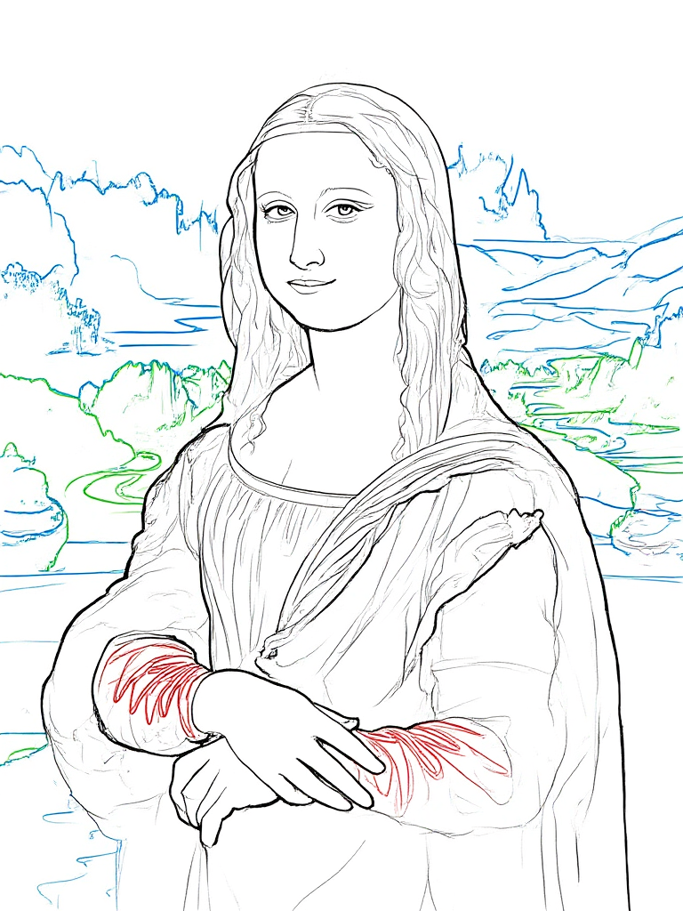
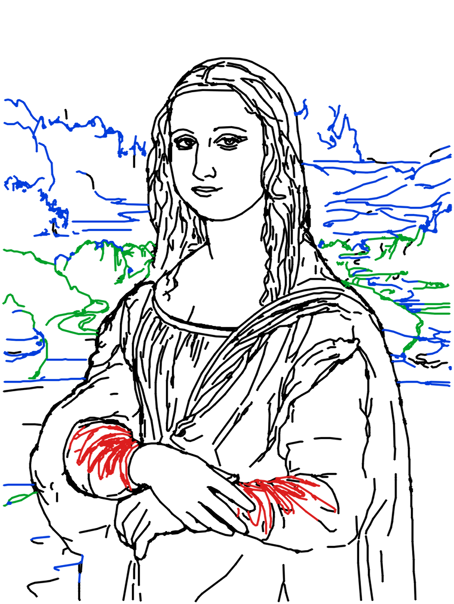
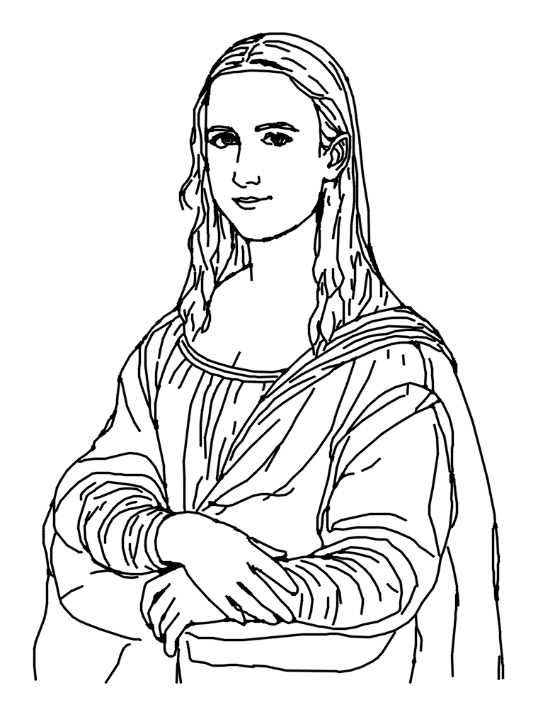

# UR Drawing Script

Turn an image into a pen drawing for a **Universal Robots (UR)** arm. The tool turns an image into strokes and writes ready-to-run **URScript** programs, one per pen colour, plus a preview of what the robot will draw.

### Best result: AI colour line drawing

An AI model (FLUX.1 Kontext) redraws the image as a clean, coloured line drawing. Every line is then traced into one robot pen stroke and written to the script of its pen colour.

| Source | AI line drawing (FLUX.1 Kontext) | Robot drawing, 4 pens |
|---|---|---|
|  |  |  |

That gives 953 strokes, 534 black, 222 blue, 124 green and 73 red, and about 10 min of drawing. The preview is drawn at the real pen width (0.5 mm).

### Other styles

| Comic style, 2 pens | SD 1.5 restyle + comic, 2 pens | Kontext line art, 1 pen |
|---|---|---|
|  |  |  |

## Features

- **Three drawing styles**
  - `lineart`: traces a line drawing (for example the AI output) line for line. Each drawn line becomes one pen stroke along its centre, lines run on straight through crossings, and thick ink such as pupils is filled.
  - `edges`: clean outlines, from Canny edge detection.
  - `comic`: ink lines plus shading. The shading is drawn in one of four fill styles: `zigzag` (default, V-shaped scribble), `z-lines`, `serpentine` or classic `lines`.
- **Up to 4 pen colours** (black, green, red, blue). Each stroke gets the matching pen, and one script is written per colour. In line art, each line keeps the colour it was drawn in.
- **Optional AI restyle, with two models to choose from.** Both need an NVIDIA GPU.
  - **FLUX.1 Kontext**, 4-bit via [Nunchaku](https://github.com/nunchaku-tech/nunchaku). This gives the best results. It redraws the photo as a clean line drawing from a text instruction, in colour if you ask for it.
  - **Stable Diffusion 1.5 + lineart ControlNet**. It is faster, about 2 s per image, and redraws the image as a comic.
- **Tk GUI**:
  - Shows the source, the AI-styled source and the robot drawing side by side.
  - Drag and drop an image, and every setting updates the preview live.
  - The estimated drawing time is shown per pen.
  - Live webcam mode, refreshed every few seconds.
  - One-click save of the image, AI image, preview and scripts.
  - **Online** tab: send the drawing straight to the robot over TCP/IP, with a connection test, jog buttons, Start, Stop and a speed slider (see [Online](#online-send-the-drawing-straight-to-the-robot)).
- **Previews**: a preview PNG is written for every result, so you can check it before the robot moves.

## Requirements

- [uv](https://docs.astral.sh/uv/). Each script declares its own dependencies, so `uv run` installs everything automatically. No manual `pip install` is needed.
- A UR robot with PolyScope and a pen mounted on the tool flange.
- Optional, for AI restyle:
  - **FLUX.1 Kontext**:
    - an NVIDIA GPU with 8 GB of VRAM or more, plus about 20 GB of disk for the model weights. Below 12 GB the worker switches to a low-memory mode automatically, which keeps the model in system RAM (16 GB or more recommended) and streams layers to the GPU.
    - a free [Hugging Face](https://huggingface.co) account (see [AI colour line drawing](#ai-colour-line-drawing-best-result))
    - On Windows 11 with **Smart App Control** switched on, Nunchaku's compiled module is blocked ("An Application Control policy has blocked this file"), and Kontext can't run.
  - **Stable Diffusion 1.5**: about 6 GB or more of VRAM, plus about 3.5 GB of disk.

Tested on Windows 11 with an RTX 4060 Ti 16 GB (Kontext: about 30–40 s per image at 1024 px) and an RTX 5070 Laptop GPU 8 GB (Kontext in low-memory mode: about 40 s per image at 1024 px; SD 1.5: about 2 s).

## Quick start

Run all commands from the repository root.

**GUI**

```
uv run src/robot_painter_gui.py
```

Drop an image onto the window, choose a style and the pens, check the preview, then press **Save** (Ctrl+S). The files are written to `output/`.

### AI colour line drawing (best result)

1. **One-time setup.** Accept the FLUX.1 Kontext licence on its [Hugging Face page](https://huggingface.co/black-forest-labs/FLUX.1-Kontext-dev), then log in once:
   ```
   uvx hf auth login
   ```
   The first start downloads about 10 GB of weights, which takes a few minutes.
2. **Choose the model.** In the GUI, open the **AI** tab, tick **AI restyle before drawing** and choose **FLUX.1 Kontext (Nunchaku 4-bit)** as the model. The style switches to **Line art** automatically, and the Edges, Comic and Fill settings are disabled.
3. **Choose the pens** you want to use.
4. **Write an instruction that names a colour for each object.** Kontext ignores a plain list like "use black, green, red and blue". It does draw coloured lines when each colour is tied to an object. The colour Mona Lisa above was made with:
   > Make a coloring-book line art of this painting using coloured outlines only: blue outlines for the sky and the river, green outlines for the hills, trees and landscape, red outlines for the lips, black outlines for the woman, her face, hair and dress. White background, no fill, no shading.

   Name the objects in your own picture, for example "red outlines on the tulips, green outlines on the leaves and stems, black outlines everywhere else". Generic wording such as "outline red objects in red" tends to produce coloured *fills* instead of lines. For a single black pen, the default instruction is enough.
5. **Check the preview** in the right-hand panel, then **Save**.

The **Line art** tab fine-tunes the tracing. **Ink darker than** drops faint lines, and **Pen width** sets both the fill spacing and the preview line width. **Colours from** is set to *drawing* by default, so each line uses its own colour; *photo* takes the colour of the original photo under each line instead.

The Kontext worker can also be run on its own:
```
uv run src/kontext_worker.py --selftest images/monalisa.png        # writes images/monalisa_kontext.png
```

**Command line**

```
# outlines, single black pen  ->  monalisa.script + monalisa_preview.png
uv run src/image_to_urscript.py images/monalisa.png

# comic style
uv run src/image_to_urscript.py images/monalisa.png --style comic

# comic style with four pens  ->  monalisa_black.script, monalisa_red.script, ...
uv run src/image_to_urscript.py images/monalisa.png --style comic --colours black,green,red,blue

# trace an (AI) line drawing, keeping its line colours  ->  one script per pen
uv run src/image_to_urscript.py images/monalisa_kontext_colour.png --style lineart --colours black,green,red,blue

# custom output name and drawing width (mm)
uv run src/image_to_urscript.py photo.jpg -o photo.script --width 120
```

| Option | Meaning |
|---|---|
| `image` | Input image (PNG, JPG, …) |
| `-o, --output` | Output `.script` path (default: next to the image) |
| `--width` | Drawing width in mm (default 150; height follows the aspect ratio, max 200) |
| `--style` | `edges` (default), `comic` or `lineart` |
| `--colours` | Comma-separated pens. Writes one `<name>_<colour>.script` per pen that has strokes |
| `--colour-from` | (`lineart`) Take line colours from this photo instead of from the drawing |

All other settings are constants at the top of [`src/image_to_urscript.py`](src/image_to_urscript.py), and every one of them is also available in the GUI. They cover canvas size and offset, pen up/down height, tool orientation, speeds, blend radius, edge and ink thresholds, tone levels, fill style and layers, and colour matching.

## Running on the robot

The generated programs draw relative to a PolyScope **feature named `Feature1`**, which defines the canvas.

1. **Define the feature.** In the robot installation, create a plane feature `Feature1` on the drawing surface. Its origin is the lower-left corner of the drawing, its X axis points to the right and its Y axis points up the image.
2. **Load the program.** Load the `.script` file into a **Script** node in a PolyScope program.
3. **Check before the first run, ideally with the pen raised:**
   - **Pen lift direction.** The pen lifts by `PEN_UP_Z_MM` (+10 mm) along the feature's Z axis. If that axis points *into* the canvas, set a negative value.
   - **Mirroring.** If the drawing comes out mirrored, use `FLIP_X` / `FLIP_Y`.
   - **Tool orientation.** The orientation `ORIENT_RX/RY/RZ` was tuned for one specific end effector. Each script logs the start TCP pose in base and feature coordinates (`textmsg`), so you can find the right values for your tool.
   - **Canvas size.** Make sure the canvas fits the drawing size (default 150 × 200 mm).
4. **Multiple colours.** Each colour is its own program, and its header names the pen (`# PEN COLOUR: RED`). Run them one after another and change the pen in between.

Each program defines small helpers (`pen_to`, `line_to`, `pen_up`) and then makes one `movel` call per point. Within a stroke the moves are blended, and the blend radii are capped so neighbouring blends never overlap, which UR rejects. [`urscript/URScript.script`](urscript/URScript.script) is a minimal hand-written test that draws a 100 mm square relative to `Feature1`.

The time estimate is a lower bound: it ignores acceleration and pen changes.

### Online: send the drawing straight to the robot

The GUI's **Online** tab sends the drawing directly to the robot over TCP/IP, so no `.script` files have to be copied to the pendant. It follows the "Sending Multiple Line Scripts" example of the Universal Robots guide [UR remote control via TCP/IP](https://forum.universal-robots.com/t/guide-and-example-ur-remote-control-via-tcpip/32973). One complete `def … end` program per pen is sent to the robot's primary interface (port 30001, or 30002), and the controller runs it immediately.

1. **Robot.**
   - **Network.** Connect the PC and the robot to the same network.
   - **Remote mode (e-Series).** e-Series robots only accept scripts from outside in **Remote Control** mode. Enable it under *Settings → System → Remote Control*, then switch the pendant to *Remote*.
2. **Address.** Enter the robot's **IP address** and **port**.
3. **Canvas pose.**
   - **Why it's needed.** A program sent this way runs outside PolyScope's generated program, so the installation feature `Feature1` is not available. Enter the canvas pose instead: `Feature1` in the robot base frame, as `p[x, y, z, rx, ry, rz]` in metres and radians.
   - **Where to find it.** `Feature1` only exists inside PolyScope, so its pose can't be read from the PC. Run [`urscript/print_feature_pose.script`](urscript/print_feature_pose.script) once in a PolyScope Script node. It doesn't move the robot; it logs `Feature Pose: p[…]` and shows the value in a popup. Every generated `.script` file logs the same line when it runs.
   - **Saved.** The IP address, port, pose and the drawing orientation are remembered between sessions.
4. **Test the robot.** Before the first drawing, check the link in the **Test the robot** panel:
   - **Test connection** connects without moving anything and reports whether the controller answers.
   - **Go to canvas origin +10 mm.** After a confirmation, the tool moves in a straight line (50 mm/s) to 10 mm above the canvas origin (`Feature1` 0,0,0), on the pen-up side and with the drawing's tool orientation. If the canvas pose, the TCP and the orientation are right, the pencil tip stops just above the canvas corner, pointing the way it will draw.
   - **Read position** sends nothing to the robot. It reads the tool (TCP) position from the robot's status data and shows it in base coordinates and, with a canvas pose entered, in canvas coordinates. It also shows how far the tool is from the "Go to canvas origin" target, and the angle between the tool and the drawing orientation. Use it to see by how much, and in which direction, the robot is off.
   - **Use current tool orientation for drawing.** Position the pencil the way it should draw (e.g. with freedrive or the pendant), then press the button. It reads the tool's orientation relative to the canvas and, after a confirmation, sets Orientation RX/RY/RZ in the Robot tab to it. The robot doesn't move. The default (1.6, −1.4, −0.8) comes from the original test program and only fits the Feature1 it was tuned for; with a Feature1 taught along the tool axes the right values are about (0, 0, 0).
   - **Log robot pose** writes the current tool (TCP) pose to the pendant's Log tab and shows it in a popup there, without moving. It also reads the same pose from the robot, shows it in the GUI and copies it to the clipboard. With a canvas pose entered, it also logs the tool position in canvas coordinates. Note that this is the *tool* pose, not `Feature1`.
   - **Jog buttons** (+X, −X, +Y, −Y, +Z, −Z) move the tool in a straight line by the **Step** set on the slider (0.5–50 mm), slowly (20 mm/s) and without changing its orientation.
   - **Axes.** With a canvas pose entered, the jog moves along the canvas axes, the same directions the drawing uses. That makes it a good check that X, Y and pen-up (+Z) point where you expect. Without a pose, the jog moves along the robot base axes.
   - **While drawing.** Jogging is blocked while a drawing runs.
5. **Pen and speed.** Choose the **pen** to draw (one pen at a time) and set the **speed** (10–200 % of the draw and travel speeds from the Robot tab). The tab shows the strokes of that pen and the estimated time.
6. **Start.** Press **Start drawing** and confirm. The program is sent and the robot starts straight away. A progress bar follows the estimated time.
7. **Stop.** **Stop** sends a short stop program. It replaces the running one, decelerates the robot and lifts the pen.
8. **Next pen.** For the next colour, change the pen, select it in the tab and press Start again.

The program is built by [`src/ur_remote.py`](src/ur_remote.py). It uses the same moves, blends, tool orientation and pen heights as the `.script` files.

## How it works

```
image ──► (optional AI restyle) ──► strokes in pixels ──► colour split ──► mm + simplify ──► ordering ──► URScript per pen
```

- **lineart style.** Made for line drawings such as the Kontext output. It works at a higher resolution (1200 px) so that fine, close-together lines stay apart.
  1. Pixels darker than the ink threshold become ink, without small specks.
  2. Zhang–Suen thinning reduces every line to its 1-pixel centre line. The small L-shaped "staircase" steps that thinning leaves behind are removed, so they don't look like junctions, and short side spurs are pruned.
  3. The centre lines are cut at real junctions into chains. At every junction the chain ends are paired up by how straight they continue, so a line crossing or touching another one runs on as a single stroke.
  4. Strokes are smoothed so they don't follow the pixel staircase, then simplified to 0.1 mm.
  5. Ink wider than about two pen widths (pupils, bold lashes, eyebrows) is filled with nested outlines one pen width apart.
  6. **Colours.** Each ink pixel keeps the pen closest to its own colour, and the pale anti-aliased edge of a line follows the line's core. A line is only split where its colour really changes, not where it crosses a line of another colour.
- **edges style.** Blur, then Canny, then trace the 1-pixel edges into open polylines.
- **comic style.**
  1. Equalise the contrast and flatten the image with an edge-preserving filter.
  2. Posterise into a few tones (k-means).
  3. Draw ink lines with an XDoG-style difference of Gaussians, thinned to centre lines.
  4. Shade the tone regions. Each fill layer `(angle, spacing mm, max tone)` covers all regions at or darker than its tone, so the darkest areas get a second pass in a crossing direction.
     - **Fill styles.** Each area is cut into parallel fill lines, which are then drawn in one of four ways:

       | Fill style | Pen path | Mona Lisa, 4 pens |
       |---|---|---|
       | `zigzag` (default) | `V V V`: only diagonals, from one edge of the area to the other, one line further each time, like scribbling with a pencil | 220 strokes, ~4.8 min |
       | `z-lines` | `Z Z Z`: each line drawn in the same direction, then a diagonal back to the start of the next | 226 strokes, ~7.6 min |
       | `serpentine` | back-and-forth lines joined by short turns, rounded if `FILL_ROUND_TURNS` is on | 202 strokes, ~5.2 min |
       | `lines` | separate hatch lines, with a pen lift after every line | 702 strokes, ~8.4 min |

       In the chained styles the pen stays down across a whole area. A path only breaks where a connecting move would leave the area and draw over white.
     - **Follow shape.** Elongated regions are filled along their own long axis; round ones keep the layer angle.
     - **Jitter.** A small, repeatable random variation in spacing and line ends makes the result look less machine-made.
- **Pen colours.**
  - **Pen per pixel.** Every pixel is assigned the closest active pen. In the default *hue* mode, grey and dark areas go to black and coloured areas go to the pen with the nearest hue. *Nearest colour* mode is meant for flat graphics.
  - **Paper.** White paper takes the colour of the nearest inked area, so outlines are drawn in the object's colour.
  - **Splitting.** Lines are cut where the pen colour changes.
- **Back end.** Convert to mm in the feature frame (image Y up), simplify with Douglas–Peucker, drop very short strokes, then order the strokes nearest-neighbour to reduce pen-up travel.
- **AI restyle.** Each model runs as a separate worker process with its own PyTorch environment, so the GUI stays lightweight. Only one worker runs at a time, and the GUI caches the AI image, so changing drawing settings doesn't re-run the model.
- **FLUX.1 Kontext worker** ([`src/kontext_worker.py`](src/kontext_worker.py)).
  - **Model.** FLUX.1 Kontext [dev], an instruction-following image editor. The transformer and the T5 text encoder are 4-bit quantised with Nunchaku: INT4 on RTX 20/30/40 cards, FP4 on RTX 50 cards.
  - **Alignment.** The output has exactly the input size, so the drawing lines up with the photo.
  - **Tuning.** In the **AI** tab you can set the instruction, size, steps, guidance and seed.
- **Stable Diffusion worker** ([`src/diffusion_worker.py`](src/diffusion_worker.py)).
  - **Models.** It uses Stable Diffusion 1.5 (`stable-diffusion-v1-5/stable-diffusion-v1-5`) with a lineart ControlNet (`lllyasviel/control_v11p_sd15_lineart`).
  - **First use.** The models download to the Hugging Face cache (about 3.5 GB), which takes a few minutes.
  - **Speed.** After that, one image takes about 2 s on an RTX 5070 Laptop GPU.
  - **Tuning.** In the GUI's **AI** tab you can set the prompt, strength, lineart guidance, steps and seed.
  - **Self-test:** `uv run src/diffusion_worker.py --selftest images/monalisa.png`

## Project layout

```
src/
  image_to_urscript.py   image → strokes → URScript (CLI + core library)
  robot_painter_gui.py   Tk GUI: drag & drop, live preview, webcam, save
  kontext_worker.py      optional AI worker: FLUX.1 Kontext, 4-bit via Nunchaku (best)
  diffusion_worker.py    optional AI worker: Stable Diffusion 1.5 + lineart ControlNet
  ur_remote.py           online mode: build one program per pen and send it to the robot over TCP/IP
urscript/
  URScript.script        hand-written 100 mm square test program
images/                  input images
examples/                generated sample output
  edges/                 outline style, one pen
  comic/                 comic style, one pen
  colour/                comic style, colour pens (+ colour map)
  ai/                    SD 1.5-restyled source → comic style, colour pens
  lineart/               Kontext line drawing → line art, one pen
  lineart_colour/        Kontext colour line drawing → line art, four pens
output/                  GUI save folder (not committed)
```

## Notes

- **OpenCV build.** The code uses `opencv-python-headless`, not `opencv-contrib-python`, because the contrib DLL is blocked on machines with Windows Application Control. Line thinning (Zhang–Suen) is therefore implemented in numpy.
- **Safety checker.** The AI worker loads model weights only as `safetensors`. Stable Diffusion's built-in safety checker is disabled to save GPU memory.

## License

[MIT](LICENSE). The AI models downloaded at runtime have their own licences:
- FLUX.1 Kontext [dev] is under the FLUX.1 [dev] **non-commercial** licence.
- Stable Diffusion 1.5 is under CreativeML OpenRAIL-M.
- The ControlNet and the Nunchaku weights are under their own licences on Hugging Face.

The AI-generated sample images in `images/` were made with FLUX.1 Kontext [dev].
